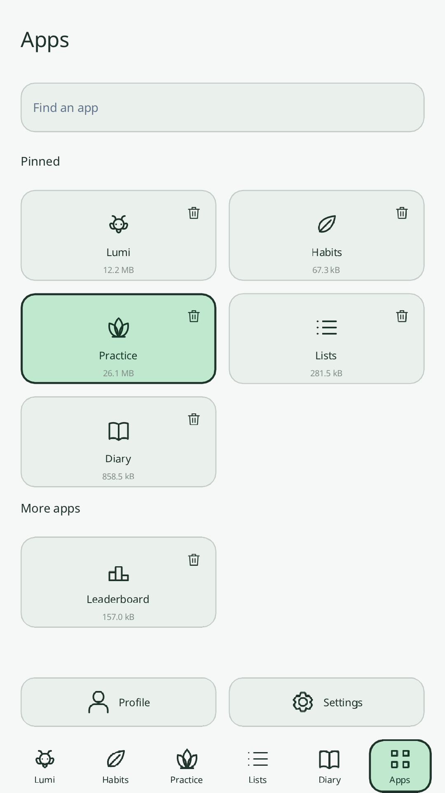
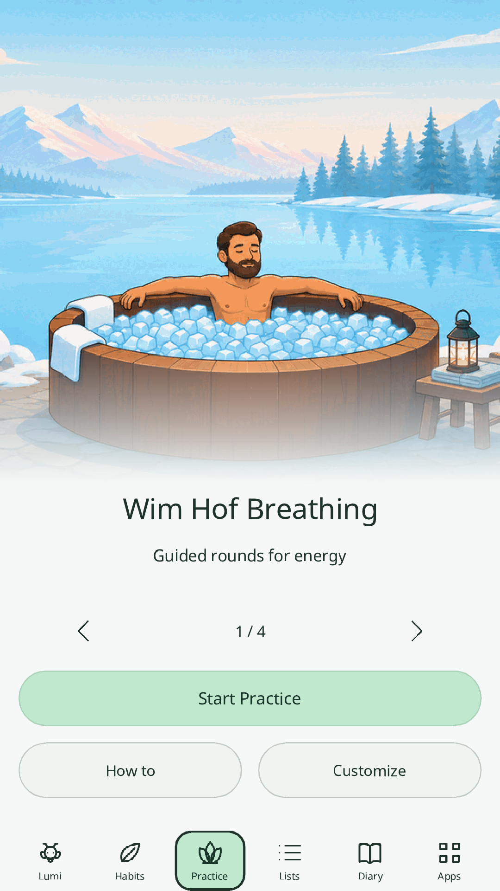
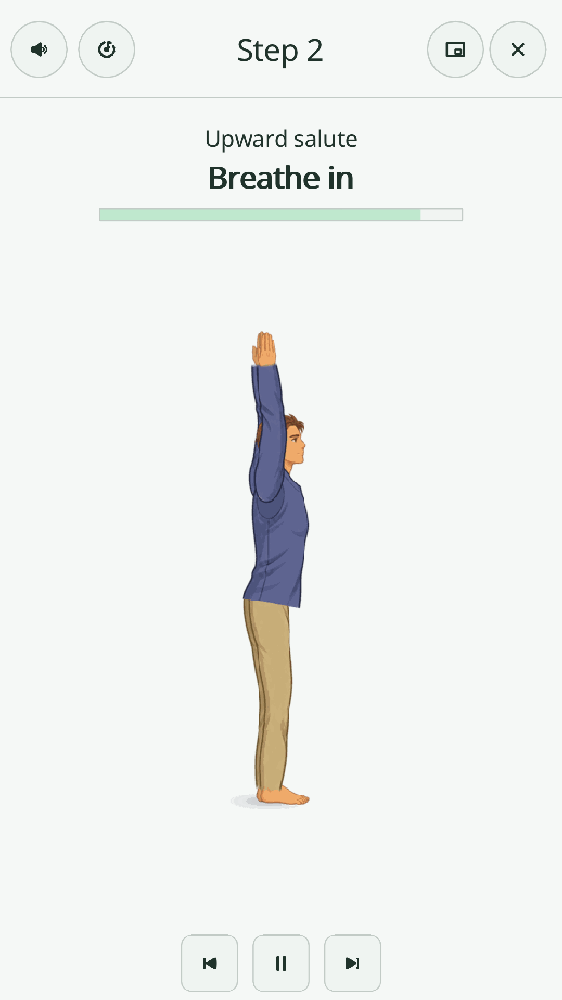
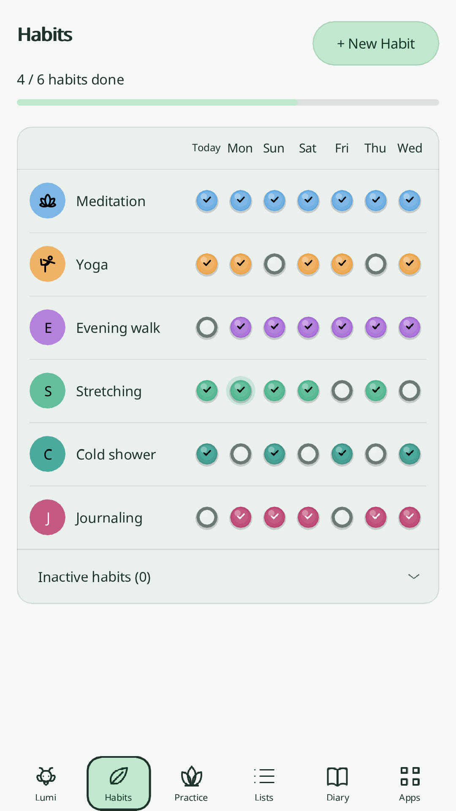
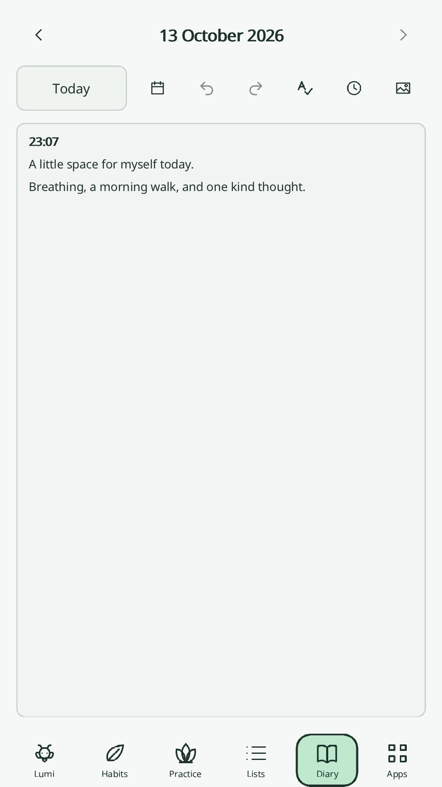
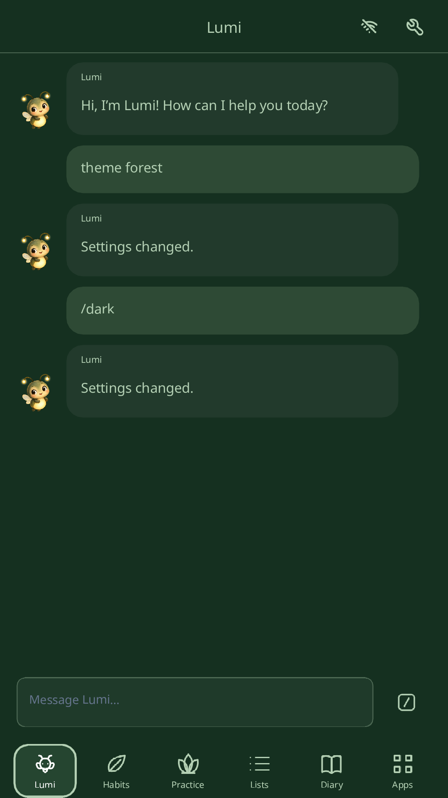

<p align="center">
  
</p>

<p align="center">
  <a href="https://play.google.com/store/apps/details?id=xyz.waozi.inbe">
    
  </a>
  <a href="https://f-droid.org/packages/xyz.waozi.inbe/">
    
  </a>
</p>

# Inner Breeze

Free, open-source apps for breathing, meditation, habits and everyday life.
Use them offline, keep your data on your device, and optionally connect an
account to sync across devices.

[Download the latest release](https://github.com/waozixyz/inbe/releases/latest)
· [What's new](CHANGELOG.md)

## Make space for yourself

- **Practice:** guided breathing, meditation, Astral Projection, Sun Salutation,
  a 7-Minute Workout, with animated guides and optional narration.
- **Habits:** track daily goals, practices and habits you want to avoid; follow
  your history and choose your own rewards.
- **Diary and Photos:** write, reflect and keep pictures together, with shared
  photo storage and automatic compression of new uploads.
- **Lists:** organize tasks and share lists with friends, choosing who can
  read, edit or manage them.
- **Lumi:** a firefly companion for starting practices, managing habits and
  changing your app. Offline commands work without an AI connection.
- **Your apps:** arrange Apps as a list or grid, choose colours and icons,
  listen to ambient Radio, and explore Arcade games and achievements.

## A look inside

<p align="center">
  
  
  
</p>
<p align="center"><em>Apps · Practices · Sun Salutation</em></p>

<p align="center">
  
  
  
</p>
<p align="center"><em>Habits · Diary · Lumi</em></p>

Tai Chi is an optional Dew unlock outside Google Play.

## Your data and choices

Your data is stored locally. Account sync is optional. Lumi starts offline;
connecting an AI provider asks for your agreement to the data sharing shown
in the app. Use Inner Breeze's service or configure your own provider.

[Privacy policy](https://inbe.waozi.xyz/privacy.html)
· [Account recovery and sync](docs/SYNC_RECOVERY.md)
· [Appearance](docs/appearance.md)

## Build and contribute

```sh
make native
make run
```

See the [build guide](docs/building.md) for Android, web, dependencies and tests,
the [F-Droid checks](docs/fdroid.md), and
[Contributing](CONTRIBUTING.md) to report bugs or make changes.
[Report security issues privately](SECURITY.md).

BSD 3-Clause. See [LICENSE](LICENSE).
